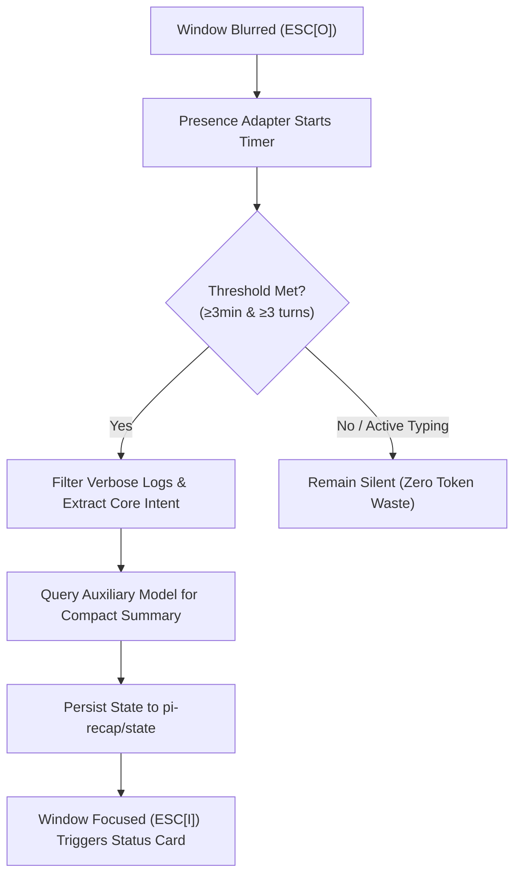

[简体中文](README.md) | English

# pi-recap

**A non-intrusive terminal session recap extension for the Pi Coding Agent.**

When developers switch away from the terminal to handle other tasks, `pi-recap` runs in the background using an auxiliary model to craft a concise session summary. When returning to the terminal, a structured card appears directly above the editor—highlighting the primary objective, completed progress, and the immediate next step to eliminate context switching fatigue.

---

## Key Features

* **Terminal Focus-Aware**: Uses the `\x1b[?1004h` protocol to track window blur and focus. Recaps are triggered only when the user is genuinely away and idle past a configurable threshold (defaults to 3 minutes and at least 3 completed turns). Active, focused sessions never trigger unnecessary model invocations.
* **Zero Context Pollution**: The generated recap is persisted as an independent Pi custom entry (`pi-recap/state`). It is never appended to the message history and does not consume future conversation token context.
* **Deterministic Branch Synchronization**: Integrates natively with the conversation tree, branch navigation, forks, and compaction. In-flight requests are automatically aborted via `AbortController` whenever the user types, switches branches, or resets sessions.
* **Adaptive Language Contract**: Automatically matches the user's primary conversational language. Enforces a strict response contract that yields 2–4 factual sentences naming exact files, commands, and concrete outcomes without conversational fluff.
* **Graceful Degradation**: Always shows its active state in the status bar (`recap on · focused` / `manual-only`); offers manual `/recap` commands on demand.

---

## Architecture & Workflow



1. **Seamless Protocol Handling**: Enables 1004 focus reporting, capturing and consuming `ESC[I` (focus) and `ESC[O` (blur) sequences without interfering with standard user inputs.
2. **Bounded Input Framing**: Strips noisy tool outputs and raw logs, extracting only the latest user goal, compaction history checkpoints, and recent intent into a compact prompt payload.
3. **Concurrency Safety**: Controlled by an isolated generation counter and abort controller. Any new keypress or session change immediately discards stale responses.

---

## Mode Support

| Runtime Environment | Automatic Away Recaps | Manual `/recap` | Notes |
| :--- | :---: | :---: | :--- |
| **Regular TUI** | ✅ | ✅ | Full terminal 1004 Focus Reporting support |
| **Fullscreen TUI** | ❌ | ✅ | Fullscreen renderer consumes raw sequences; degrades gracefully to manual |
| **RPC Mode** | ❌ | ✅ | No interactive terminal presence; provides standard command channel |
| **Print Mode (`-p`)** | ❌ | ✅ | Non-interactive execution; manual invocations supported |

*Note: In terminals without 1004 focus reporting support, the status line automatically degrades to `manual-only`.*

---

## Installation & Quick Start

### Install via Pi

```bash
pi install git:github.com/DDDFXYqiming/pi-recap
```

### Local Development

```powershell
git clone https://github.com/DDDFXYqiming/pi-recap.git
cd pi-recap
pi -e .\index.ts
```

Startup logs confirm your active configuration on stderr:
```text
[pi-recap] loaded (idleMs=180000 minTurns=3 maxChars=600 maxOutputTokens=2048 focus=auto)
```

---

## Interactive Commands

```text
/recap            Generate a recap card for the current session immediately
/recap status     Display current configuration, focus presence, turn counts, and anchors
/recap dismiss    Dismiss the active recap banner
/recap on         Enable automatic recaps (persisted to configuration)
/recap off        Disable automatic recaps (manual execution remains available)
```

Example card output:
```text
↩ recap: Session persistence and branch state isolation verified; next step is running regression tests.
```

---

## Configuration

Configuration is stored at `~/.pi/agent/pi-recap.json` and generated upon running `/recap on` or `/recap off`:

```jsonc
{
  "enabled": true,           // Toggle automatic away recaps
  "idleMs": 180000,          // Inactivity delay in ms (default: 3 minutes)
  "minTurns": 3,             // Minimum completed turns before triggering
  "maxChars": 600,           // Maximum character length for recap text
  "maxInputChars": 8000,     // Max context characters extracted for prompt
  "recentMessages": 12,      // Number of recent turns inspected for intent
  "provider": null,          // Optional: Dedicated model provider
  "model": null,             // Optional: Dedicated auxiliary model name
  "maxOutputTokens": 2048    // Maximum output token ceiling
}
```

*For debugging terminal quirks, launch with `$env:PI_RECAP_FOCUS="0"` to disable raw focus listeners and force `manual-only` mode safely.*

---

## License

This project is open-sourced under the [MIT License](LICENSE).
